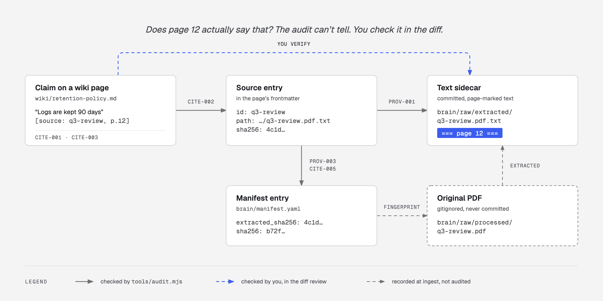
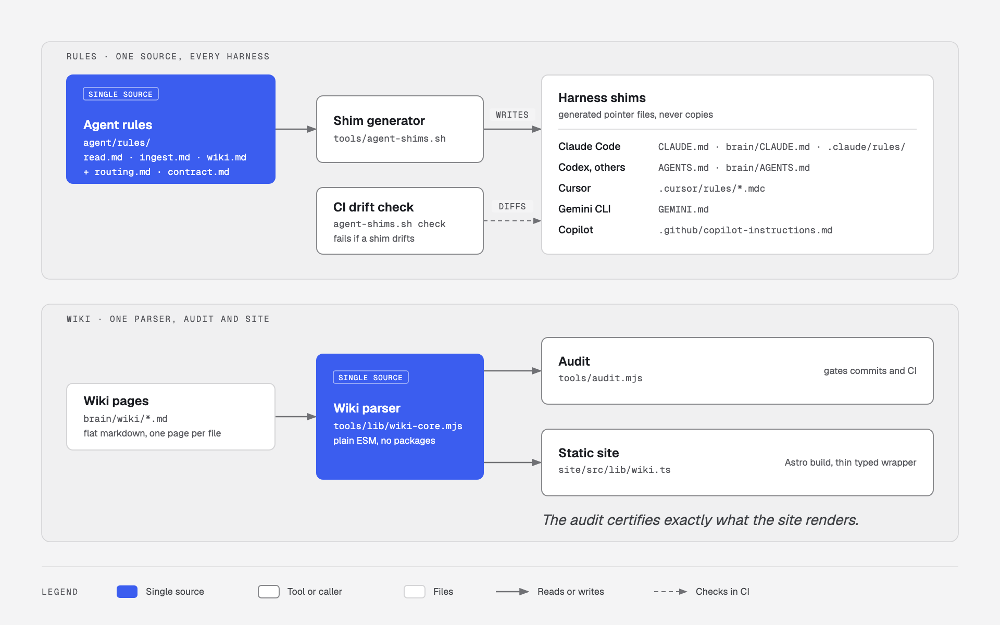

<div align="center">

```
    ▄▄▄       ██▓     ███▄ ▄███▓ ▄▄▄        ▄████ ▓█████   ██████ ▄▄▄█████▓
   ▒████▄    ▓██▒    ▓██▒▀█▀ ██▒▒████▄     ██▒ ▀█▒▓█   ▀ ▒██    ▒ ▓  ██▒ ▓▒
   ▒██  ▀█▄  ▒██░    ▓██    ▓██░▒██  ▀█▄  ▒██░▄▄▄░▒███   ░ ▓██▄   ▒ ▓██░ ▒░
   ░██▄▄▄▄██ ▒██░    ▒██    ▒██ ░██▄▄▄▄██ ░▓█  ██▓▒▓█  ▄   ▒   ██▒░ ▓██▓ ░
    ▓█   ▓██▒░██████▒▒██▒   ░██▒ ▓█   ▓██▒░▒▓███▀▒░▒████▒▒██████▒▒  ▒██▒ ░
    ▒▒   ▓▒█░░ ▒░▓  ░░ ▒░   ░  ░ ▒▒   ▓▒█░ ░▒   ▒ ░░ ▒░ ░▒ ▒▓▒ ▒ ░  ▒ ░░
     ▒   ▒▒ ░░ ░ ▒  ░░  ░      ░  ▒   ▒▒ ░  ░   ░  ░ ░  ░░ ░▒  ░ ░    ░
     ░   ▒     ░ ░   ░      ░     ░   ▒   ░ ░   ░    ░   ░  ░  ░    ░
         ░  ░    ░  ░       ░         ░  ░      ░    ░  ░      ░
```

**A knowledge base your agent can't lie to you about.**

</div>

An AI-powered knowledge base framework for coding agents.

Fork it, point it at your domain, and drop in source material. Your agent reads what you give it, proposes structured wiki pages, and refuses to write a single claim it can't trace back to a source. The result is a cross-linked markdown wiki that both you and an agent can query — plus a static site to read it in.

It runs on Claude Code, Codex, Cursor, Gemini CLI, Antigravity, or any agent that meets the [harness contract](agent/contract.md).

## About that tagline

It used to be a promise. It is now a program you can run.

`tools/audit.mjs` checks the wiki mechanically, and its exit code gates the commit. **What is enforced by code:**

| Enforced | Check |
|----------|-------|
| Every body claim on an `origin: source` page carries a citation | `CITE-003` |
| Every citation parses against one frozen grammar | `CITE-001` |
| Every citation resolves to a source declared on that page | `CITE-002` |
| Every declared source exists on disk | `PROV-001` |
| Every declared source's `sha256` still matches `manifest.yaml` — a source edited under a page's feet is a finding, not a silence | `CITE-005` |
| Every page's sources are recorded in the manifest, and every manifest entry names pages that exist | `PROV-002`, `PROV-003` |
| Every `origin: self` page carries a `## Basis` of wikilinks to sourced pages | `CITE-006` |
| Every `[[wikilink]]` and every typed relation resolves | `LINK-001`, `LINK-003` |
| Frontmatter matches the schema and the `page_types` in your config | `SCHEMA-001`…`005` |

The same checks run in CI, so a merge cannot land a page that fails them.

Here is one claim followed back to its source. Every hop is checked by the audit except the last one, which is yours:

<picture>
  <source media="(prefers-color-scheme: dark)" srcset="docs/diagrams/citation-chain-dark.png">
  
</picture>

**What is still convention, enforced by nothing but the rules and your review:**

- **That the citation is *true*.** The audit proves `[source: arch-overview, p.3]` points at a real source you really declared. It cannot read page 3 and confirm it says what the page claims it says. That is what the diff review is for — and why the text sidecar in `brain/raw/extracted/` is committed with `=== page 3 ===` markers, so checking takes seconds instead of reopening a PDF.
- **That contradictions were noticed.** Surfacing a conflict requires understanding two claims are about the same thing. The rules require it; no check proves it happened.
- **That canonical pages were respected during drafting.** `CANON-001` reports what got logged to `brain/canonical-challenges.md`. It cannot report what got quietly absorbed instead of logged.
- **That the extraction is faithful to the source.** No tool checks reading comprehension.

<picture>
  <source media="(prefers-color-scheme: dark)" srcset="docs/diagrams/who-checks-what-dark.png">
  
</picture>

The line worth holding onto: the audit makes provenance *plumbing* mechanical, so your review can spend all its attention on the part that needs a human.

## How it works

<picture>
  <source media="(prefers-color-scheme: dark)" srcset="docs/diagrams/ingest-flow-dark.png">
  
</picture>

## Where it sits

Almagest optimises for one thing — **trust in what the notes say** — and pays for it everywhere else. Named comparisons, so you can tell whether the trade is one you want:

| | Obsidian + plugins | Logseq / Roam | NotebookLM | RAG over a vault (Khoj, Onyx) | Agent memory (mem0, Letta) | **Almagest** |
|---|---|---|---|---|---|---|
| Capture speed | **excellent** | **excellent** | good | n/a — reads what you have | **automatic** | **poor** — ingest is a deliberate, reviewed operation |
| Mobile capture | **yes** | **yes** | **yes** | varies | **yes** | **no** — it is a git repo and a coding agent |
| Scale | 100k+ notes | 100k+ notes | ~50 sources per notebook | **millions of chunks** | unbounded | thousands of pages; grep and a flat wiki, not a vector store |
| Answers with citations | plugin-dependent | no | **yes**, to the uploaded source | **yes**, to the chunk | rarely | **yes**, to source + locator, and the citation is checked |
| Citation integrity checked by a program | no | no | no | no | no | **yes** — `tools/audit.mjs`, in CI |
| Conflicting sources | newest note wins | newest block wins | both summarised, conflict unmarked | both retrieved, conflict unmarked | silently overwritten | **stops and asks**, both claims quoted |
| Locked, agent-proof definitions | no | no | no | no | no | **yes** — canonical tier |
| Where the truth lives | your files | your files | **their servers** | index + your files | **their store** | **your files, in git** |
| Review surface for AI writes | none | none | none | n/a | none | **a git diff** |
| Re-ingesting an edited source | manual | manual | re-upload | re-index | n/a | **content fingerprint → targeted diff** |
| Runs offline / self-hosted | **yes** | **yes** | no | yes | varies | **yes** |

**Where Almagest loses, plainly.** If you want to capture a thought on a train, use Obsidian — Almagest has no mobile story and no inbox worth the name; a capture here means opening a terminal. If you have 40,000 PDFs, use a real RAG system — this is grep over a flat directory, and it will not embed its way out of that. If you want to ask questions of a document you read once and will never think about again, NotebookLM will do it in ninety seconds with no repo, no config, and no agent. If you want an assistant that quietly remembers things about you, mem0 and Letta are built for exactly that, and Almagest's entire design is a refusal to remember anything quietly.

**Where it wins.** When the cost of a confidently wrong note is high — when someone will make a decision on it months from now, when several people share the base, when you will be asked "where did that number come from" — the other tools have no answer and Almagest has a file path, a page number, a fingerprint, and a diff with your merge on it.

What that looks like in practice:

```
  $ <your agent>            # claude · codex · cursor-agent · gemini · agy

  ● Read brain/.index/pages.tsv (142 pages, 61 sources)
  ● Read brain/raw/q3-architecture-review.pdf (38 pages)
  ● Wrote brain/raw/extracted/q3-architecture-review.pdf.txt (38 page markers)
  ● Branch ingest/q3-architecture-review-4f1c8ab

    Written to the branch: 2 new pages, 1 update

    + wiki/service-ledger.md          type: system    5 sources
    + wiki/retention-policy.md        type: policy    2 sources
    ~ wiki/data-platform.md           +3 claims, +2 [[links]]

    ! CONFLICT — wiki/retention-policy.md          not written
        existing  "retained for 30 days"      [source: runbook, §4]
        incoming  "retained for 90 days"      [source: q3-review, p.12]
        → incoming source is newer. Recommend update, keep both cited.
          Resolve now, or it stays out of this branch.

    ? Open question logged: no source states who owns the ledger.

  ● tools/audit.mjs — 0 errors, 2 warnings (1 orphan, 1 stale)
  ● Committed 3d9e12f

    Review:  git diff main...ingest/q3-architecture-review-4f1c8ab
    Merge when you're happy. Nothing reaches main until you do.
```

## What makes it different

- **Nothing unreviewed lands.** The agent works on an `ingest/<source>-<sha>` branch and commits there; `main` moves only when you merge a diff you have read. The gate is a diff, not a summary box — because the failure that matters is not the agent writing without permission, it is the agent writing something plausible and wrong while you skim a box at 11pm and type `y`.
- **Blocking cases still stop mid-run.** Contradictions, anything touching a canonical page, deletions, merges, renames, and low-confidence curated pages are not written to the branch at all. Those are the cases a diff review is a bad place to first encounter.
- **Every claim cites its source** — down to the section, page, row, slide, or timestamp — in one frozen grammar that a program can parse. A page with no sources is a build failure, not a style note.
- **Citations point at text you can actually open.** Binary sources get a committed sidecar in `brain/raw/extracted/` with `=== page 12 ===` markers, so `p.12` resolves to a real line in a file in the repo. The PDF stays gitignored; the text it produced does not.
- **Contradictions surface instead of silently overwriting.** When a new source disagrees with what's already there, the agent quotes both, recommends a resolution, and waits.
- **Your own thinking is first-class.** An `origin: self` `claim` page holds a conclusion *you* reached — no inline citations, but a required `## Basis` of wikilinks to sourced pages. Previously this was a schema violation, which meant the brain could hold only what documents said and never what you concluded from them.
- **Unknowns are first-class.** Missing data gets named in an `## Open questions` section, not quietly omitted.
- **Canonical pages are locked.** Your agreed taxonomies and definitions are guardrails the agent cannot edit — data that contradicts them lands in `brain/canonical-challenges.md`, where you can see what was rejected and why, rather than vanishing.

## Features

- **Mechanical audit** — `tools/audit.mjs` (Node 22+) checks schema, links, citation grammar, citation targets, provenance against the manifest, orphans, and staleness. Findings carry stable IDs (`CITE-002`, `LINK-001`, …) that the rule files reference by name. Exit `0` clean, `1` violations, `2` tool error. It shares one parser with the site — `tools/lib/wiki-core.mjs`, which both `tools/audit.mjs` and `site/src/lib/wiki.ts` are thin callers of — so what the audit certifies is exactly what the site renders. Full check list in [The Audit](docs/audit.md).
- **Audit in CI** — the same run on every push, plus `--check-index` to prove the derived index is current. A page that fails does not merge.
- **AI-assisted ingest** — drop files in `brain/raw/` or pull from GitHub/GitLab repos over MCP. The agent extracts entities, proposes pages, handles contradictions, and cites sources.
- **Branch-based review** — ingest happens on `ingest/<source-slug>-<sha7>`. You get a git diff, not a terminal summary. Unattended ingest onto a branch is supported; an unattended merge to `main` is not, and there is no flag for it.
- **Structured wiki** — flat markdown with typed frontmatter, three content tiers (canonical / curated / evidence), `origin: source | self`, and automatic `[[wikilink]]` cross-linking.
- **Typed relations** — `supports`, `contradicts`, `supersedes`, `depends_on` alongside the untyped `related`. An argument graph, not just a link graph: you can ask what a claim rests on and what disagrees with it, and the audit checks that every edge resolves.
- **`claim` pages** — the author's conclusions, `origin: self`, titled as sentences, backed by a `## Basis` of wikilinks. The brain holds what you think, with the reasoning attached.
- **Extracted-source sidecars** — a committed, page-marked text extraction per binary source in `brain/raw/extracted/`. Fingerprinted, cited, greppable, diffable. The original stays out of git.
- **Derived index** — `brain/.index/pages.tsv` and `aliases.tsv`, generated and committed. Queries grep the index instead of loading the whole catalog, so retrieval costs scale with the answer rather than the corpus. `--check-index` keeps it honest.
- **Incremental re-ingest** — sources are fingerprinted by content, not filename. Edit a source, drop it back in, and the agent proposes a targeted diff against the pages it already produced instead of skipping it as a duplicate.
- **Benchmark harness** — a fixture corpus and question set that measure citation validity, contradiction surfacing, and whether the agent declines questions the corpus can't answer. Ships unrun; the numbers are yours to produce.
- **Query protocol** — ask questions, get answers traceable to the original source, with synthesis explicitly flagged as synthesis and conclusions explicitly flagged as conclusions.
- **Static site** — an Astro frontend that builds straight from `brain/wiki/`. Backlinks, filtering, dark mode, zero configuration.
- **Harness portability** — one set of rules in `agent/rules/`, projected into each agent's own format (`CLAUDE.md`, `AGENTS.md`, `.cursor/rules/`, `GEMINI.md`) by a single generator. One source of truth, no drift. Claude Code is the reference harness.
- **Upstream updates** — pull framework improvements with `git merge`. Your content and customisation live in files upstream never touches.

## The service (v2)

Everything above runs with nothing but an agent session and git. `server/` adds an optional long-running service around the same repo and the same rules — for when the brain should keep itself current and be reviewed by people who don't read diffs.

| | What it does | Guide |
|---|---|---|
| **Background ingest** | Files dropped in `brain/raw/`, scheduled connector syncs and chat submissions become jobs. A headless agent ingests each one in its own worktree with no git, network or MCP access; the service runs the audit and commits to the branch | [Ingest](docs/v2/ingest.md) |
| **Any MCP as input** | Google Drive, Granola, Linear, Notion, Slack, GitHub, GitLab, or any server that exposes resources. The service fetches, snapshots and fingerprints each item, so citations stay checkable | [Connectors](docs/v2/connectors.md) |
| **Review inbox** | Each branch becomes a proposal: every new or changed fact next to the source passage it cites, questions as decision cards. Approve in the web inbox, from chat via a confirmation link, in Slack, by email, or keep GitHub PRs. Approval is pinned to the version you saw; agents can never approve | [Governance](docs/v2/governance.md) |
| **Brain as MCP server** | Search, ask and cite the brain from Claude, Cursor or any MCP client — over stdio from a clone, or over HTTP from anywhere, with OIDC or built-in OAuth | [MCP](docs/v2/mcp.md) |
| **Demand** | Every request is recorded. Frequently read pages need stricter approval and get re-verified sooner; questions the brain couldn't answer become a gap list | [Telemetry](docs/v2/telemetry.md) |

One code path, three profiles — `service.profile` in `brain.config.yaml`:

- **solo** — your laptop or one small container. SQLite, a pasted token, approve from your phone or from chat.
- **team** — SSO sign-in, the person who submitted can't approve their own proposal, hot pages need two approvals.
- **enterprise** — Postgres, SSO required to approve, owner-team sign-off on hot pages, Slack and GitHub-PR channels, remote MCP behind your IdP.

```bash
npm install
ALMAGEST_TOKENS="me:owner:$(openssl rand -hex 16)" ALMAGEST_SECRET_KEY=$(openssl rand -hex 32) npm run serve
# inbox:  http://127.0.0.1:4747/inbox     MCP:  http://127.0.0.1:4747/mcp     or:  node server/bin/almagest.mjs mcp
```

Containers: `deploy/docker/` (the image clones your brain at start). Always-on on a laptop: `deploy/launchd/`, `deploy/systemd/`. The design and every contract between the parts: [docs/v2/spec.md](docs/v2/spec.md).

## Quick start

```bash
git clone <this-repo> my-brain && cd my-brain
```

1. **Configure** `brain.config.yaml` — page types, canonical pages, and whether you want anonymization and page ownership turned on (both ship off).
2. **Drop files** into `brain/raw/` — PDFs, docs, spreadsheets, transcripts, notes.
3. **Start your agent** in the repo root — `claude`, `codex`, `cursor-agent`, `gemini`, `agy`, whichever you use. It picks up the rules from the repo, branches, and starts writing pages. Per-harness setup in [Agent Harnesses](docs/agent-harnesses.md).
4. **Review and merge** — `git diff main...ingest/<branch>`, then merge. That is the gate.
5. **Read it** — `cd site && npm install && npm run dev`.

Full walkthrough in [Getting Started](docs/getting-started.md).

## Documentation

- [Getting Started](docs/getting-started.md) — setup and configuration
- [Agent Harnesses](docs/agent-harnesses.md) — running it on Claude Code, Codex, Cursor, Gemini CLI, Antigravity, or Copilot
- [The Audit](docs/audit.md) — every check, what it means, and how to fix it
- [Page Types](docs/page-types.md) — defining custom wiki page types
- [Terminal Output](docs/terminal-output.md) — what a run prints, and why
- [Remote Sources](docs/remote-sources.md) — ingesting from GitHub or GitLab over MCP
- [The Ingest Manifest](docs/manifest.md) — how re-ingest stays incremental
- [Benchmarks](docs/benchmarks.md) — measuring whether the wiki actually helps
- [Multi-Brain](docs/multi-brain.md) — running several knowledge domains side by side
- [Upstream Updates](docs/upstream-updates.md) — pulling framework improvements
- [v2 service](docs/v2/spec.md) — [ingest](docs/v2/ingest.md) · [connectors](docs/v2/connectors.md) · [governance](docs/v2/governance.md) · [MCP](docs/v2/mcp.md) · [telemetry](docs/v2/telemetry.md)

## Structure

Two things exist exactly once, and everything else is generated from them or calls into them, so nothing can drift:

<picture>
  <source media="(prefers-color-scheme: dark)" srcset="docs/diagrams/one-source-dark.png">
  
</picture>

| Path | Purpose |
|------|---------|
| `brain/wiki/` | Flat markdown pages — the source of truth |
| `brain/raw/` | Intake queue for new source files |
| `brain/raw/extracted/` | Committed, page-marked text sidecars for binary sources |
| `brain/.index/` | `pages.tsv` + `aliases.tsv` — generated by the audit, committed, never hand-edited |
| `brain/index.md` | Catalog of every page and every source (for humans) |
| `brain/manifest.yaml` | Fingerprint record of every ingested source (for the agent) |
| `brain/canonical-challenges.md` | Data that contradicts a canonical page — logged, never merged |
| `brain/log.md` | Audit trail of every action |
| `site/` | Astro frontend, reads from `brain/wiki/` |
| `server/` | The v2 service — background ingest, connectors, review inbox, MCP server, telemetry |
| `deploy/` | Docker image and compose, launchd and systemd units for the service |
| `agent/contract.md` | The minimum capabilities a harness must have to run Almagest |
| `agent/rules/` | The agent rules — read, ingest, wiki write. One copy, every harness |
| `tools/audit.mjs` | The audit — schema, links, citations, provenance. Gates every commit and CI run |
| `tools/lib/wiki-core.mjs` | The one wiki parser. The audit and the site are both callers; neither has a copy |
| `tools/agent-shims.sh` | Generates the per-harness rule files from `agent/rules/` |
| `.claude/rules/` | Claude Code rule shims (generated) |
| `.github/workflows/` | CI — audit, index check, and shim drift check |
| `benchmarks/` | Benchmark harness, fixture corpus, and question set |
| `benchmarks/drivers/` | One driver per harness — how the benchmark invokes an agent |
| `docs/` | Framework documentation |
| `brain.config.yaml` | Instance configuration |
| `.mcp.json` | MCP servers the connectors read from |

## Requirements

- **An AI coding agent** meeting [`agent/contract.md`](agent/contract.md). Known-good: [Claude Code](https://claude.com/claude-code) (the reference harness), Codex, Cursor, Gemini CLI, Antigravity, Copilot. Setup per harness in [Agent Harnesses](docs/agent-harnesses.md).
- **Git, and a human who merges.** The agent commits to a branch; `main` moves only when a person merges a reviewed diff — or, with the service, approves the exact version in the review inbox and the service merges for them. There is no auto-merge mode in either.
- **For the service only:** Node.js 22.13+ (it uses the built-in `node:sqlite`) and git 2.38+ (`merge-tree --write-tree`). `node server/bin/almagest.mjs doctor` checks both.
- **Node.js 22+** — for `tools/audit.mjs` and for the site (the site needs 22.22+, Astro 7's floor). This is a hard dependency now, not a site-only one: the audit and the site call the same parser (`tools/lib/wiki-core.mjs`) rather than keeping two that would drift apart, and Node cannot import the site's TypeScript, so the shared file is plain ESM. The site still builds from `cd site && npm install && npm run build` on a fresh clone with no root install — the core imports no packages, by design.
- `shasum -a 256` or `sha256sum` — for source fingerprinting.
- Bash and coreutils — for `tools/agent-shims.sh` and the benchmark harness, which deliberately need no language runtime at all.

## License

MIT — see [LICENSE](LICENSE).
