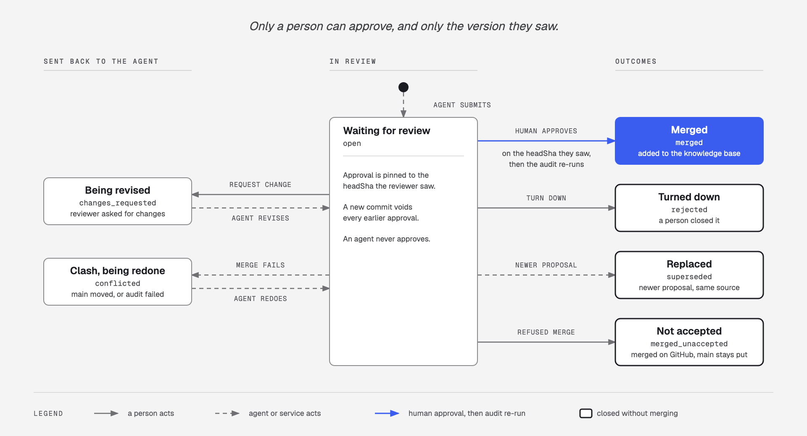

# Governance — reviewing what the agent wants to add

Almagest's agent reads sources and writes wiki pages, but it never changes the
knowledge base on its own. Everything it writes arrives as a **proposal** that a
person reviews and approves. This page explains how that works, for the people
who review and for the people who set it up.

Code: `server/src/governance/`. Contract: [`spec.md`](spec.md) → Governance.

---

## For reviewers

### What you see

Open the **review inbox** (`/inbox` on your Almagest server). Each entry is one
proposal, the agent's work on one source:

> **New material from “Q3 board deck”**
> 3 new facts, 1 updated fact about Acme and Pricing · 1 question needs you

Entries with a question for you come first, then ones touching frequently-read
pages, then the oldest.

Each row shows the document's own name (the source's title, not a file path),
its path or reference in small type underneath, how many pages and facts change
(`+12 ~1 -0` is twelve facts added, one changed, none removed), what it is
waiting for, and how long ago it was sent.

Open one and you see three things.

**The header** stays at the top as you scroll. It has the document's name, the
path or reference under it, and one line saying how many pages are new and
changed, how many facts are added, changed and removed, and when it was sent.
On the right are the status, what is still needed in a few words, the
**Approve all** button, and a **More** menu with "Ask for changes" and "Turn
down".

**The contents** list sits on the left and stays in view. It starts with the
questions you must answer first, when there are any. Then come the pages, new
ones first, then changed ones, then renamed and removed ones. Each shows
whether it is new, changed or removed, its tier, how many facts it adds,
changes and removes, and whether you have accepted it ("2 of 3 pages
accepted"). Other files (the index, the log, the manifest, source copies) are
one folded group at the bottom. Choosing an entry jumps to it, and the entry
for the part you are reading is highlighted. On a narrow screen the contents
move above the page.

**The pages** come next, each with its own header that stays in view while you
read it: the title, the tier (change it from there), the view choice, and
**Accept page** and **Take this page out**.

Each page has two views. Choose with the switch in its header. The choice is
kept in the address (`?view=compare` or `?view=page`) so you can share the link,
and it stays when you accept, take out or answer something.

- **Compare** (the default) answers *is each thing we are about to write
  supported by the source?* On the left is each fact exactly as it will be
  written: new, changed (with the old wording struck through above it) or
  removed. On the right is the passage from the source that it cites, with the
  source's name and the spot written once above it. Facts in a row that cite the
  same spot share one passage, which stays in view while those facts scroll.
  The words in the passage that also appear in the fact are marked, so you can
  see what supports it. You are checking one thing: *does the source say
  this?*
- **Whole page** answers *what will the wiki say?* A new page shows its details
  (title, type, tier, confidence, tags, aliases, sources) and then its whole
  text, with each `[source: …]` shown as a small tag. A changed page shows what
  changed between the version the agent started from and the version you are
  reviewing, one column by default or side by side (`?diff=split`), with the
  changed words inside a line highlighted. Stretches that did not change are
  folded ("14 unchanged lines"), and one click opens them. A removed page shows
  the text that would go. Any fact without a checked source is listed above the
  text with its warning, so switching view never hides one.

A page longer than 200 KB is cut: you see the first part, and a note says how
large it is and that the rest is not shown. Approving still adds all of it.

If the passage can't be found, the right column says so ("We couldn't find that
spot in the source. Check it by hand before you approve."). A fact with no
source shows its warning there too, so an unsupported fact is a visible gap,
not a missing block. Treat any of these as a reason to look closer.

Below the pages, **Other files** lists everything else the proposal adds or
changes (the index, the manifest, the log, sidecars under `brain/raw/`) with
its size and what it says: the first 40 lines of a new file, the added lines
of a changed one. Approving the proposal approves these too. Each file is
folded; a new file that is not one of the usual bookkeeping files starts open.

**Keys** (only when scripts run; everything works without them). `j` and `k`
move to the next and previous fact, `n` and `p` to the next and previous page,
`v` switches the view of the page you are on, and `?` lists them. No key accepts,
takes out, approves or turns anything down. Those are always a click. Keys are
left alone while you type in a field.

### What you can do

| Button | What happens |
|---|---|
| **Approve all** | Your approval is recorded. When every requirement is met, the proposal is added to the knowledge base straight away. |
| **Accept page** | Approves one page. Some pages (frequently read, or owned by a team) need this explicit look. Accepting every page one by one is the same as approving all. |
| **Take this page out** | The agent removes that page from the proposal; the rest stays. |
| **Ask for changes** | Write what's wrong. The agent revises and the proposal comes back to you. |
| **Turn down** | Nothing from this proposal is added. |
| A question's answer buttons | When the agent hit something it may not decide alone — two sources disagree, a page would be deleted or merged, it isn't sure — it asks. Your answer goes to the agent, which revises. |

The box **"Before this can be added"** always says, in a sentence, what is
still missing: *"Needs 1 more approval from someone in team engineering for the
page “Pricing”."*

### Things that are always true

- **Only people approve, signed in.** A chat assistant, a script or the agent
  itself can never approve, whatever the settings say, and neither can an
  access token, even yours: approving happens in your signed-in browser (or by
  a Slack button / GitHub merge Almagest can verify was you).
- **You approve what you saw.** Every Approve button carries the exact version
  on your screen. If the proposal changed in the meantime, nothing is approved
  and you are shown the new version. If it changes after you approved it (the
  agent revised it), your approval stops counting, and the page says whose
  approvals no longer count.
- **One person, one approval.** Approving in the inbox and again from Slack is
  still one approval.
- **Only the knowledge base.** A proposal that would change anything besides
  wiki pages, sources and the knowledge base's own records (the audit tool,
  the service, the configuration, git settings …) can never be approved.
- **Questions first.** A proposal with an unanswered question can't be added.
- **The automatic checks must pass**: on the proposal, and again on the result
  of combining it with the current knowledge base.
- **Locked reference pages** (canonical pages) are never changed by a proposal.
  If new material disagrees with one, the disagreement is written down as a
  *challenge* in `brain/canonical-challenges.md`, where a person can weigh it.
  The page itself stays as it is.

<picture>
  <source media="(prefers-color-scheme: dark)" srcset="../diagrams/proposal-lifecycle-dark.png">
  
</picture>

### Approving from elsewhere

- **From a chat** (Claude, ChatGPT, … via Almagest's MCP server): ask the chat
  to approve and it gives you a link with a code like `K7Q2-9XMA-PD4T`. The
  link opens the full review (the same page as from the inbox, with a note
  that the chat asked), and you approve there. The chat cannot do it for you.
  Codes work once and expire after 15 minutes.
- **From Slack**: notifications have Approve / Request changes / Open buttons.
  Approve works only if your Slack account is linked to your Almagest account.
- **From email**: links in the email open the inbox. A personal link signs you
  in once ("Continue as Ada"); opening it never approves anything by itself.
- **From GitHub**: for teams that prefer pull requests: merging the PR counts
  as your approval.

---

## For administrators

### Profiles

`service.profile` in `brain.config.yaml` picks defaults; every key can be
overridden, with one exception: `enterprise` requires single sign-on, so
`service.auth.provider` must be `oidc` and the service refuses to start
otherwise. Use `team` if you need token sign-in. The approval rules in the
table are the profile's own rules; your `governance.rules` are added to them
(see [Approval rules](#approval-rules)).

| | `solo` | `team` | `enterprise` |
|---|---|---|---|
| Sign-in to the inbox | token (paste) | single sign-on (OIDC) | single sign-on (OIDC) |
| Separation of duties | off | on | on |
| Ordinary proposal | 1 approval | 1 approval | 1 approval |
| Frequently-read ("hot") page | 1 explicit page approval | 2 explicit page approvals | 2 explicit page approvals, one from the page's owner team |
| `canonical_conflict` question | — | — | answered and approved by an `owner` |
| `require_sso_for_approval` | off | off | on |
| Channels | web, mcp | web, mcp, slack | web, slack, github-pr |

### Sign-in

```yaml
service:
  http: { base_url: https://brain.acme.com }   # links in Slack/email/PRs use this; https → Secure cookies
  auth:
    provider: token            # token: a sign-in secret at /inbox/login, or `almagest login`
    tokens_env: ALMAGEST_TOKENS  # people, roles, API tokens: "ada:owner:<api token>;bob:reviewer:<api token>"
    logins_env: ALMAGEST_LOGINS  # inbox sign-in secrets: "ada:<sign-in secret>;bob:<sign-in secret>"
    session_hours: 12
    # provider: oidc
    # oidc:
    #   issuer: https://login.acme.com/realms/brain
    #   client_id: almagest-web
    #   client_secret_env: ALMAGEST_OIDC_SECRET    # omit for a public client (PKCE only)
    #   audience: almagest                         # bearer-token audience (core/auth-oidc.mjs)
    #   roles_claim: realm_access.roles            # dotted path
    #   teams_claim: groups
    #   role_map: { brain-owners: owner, brain-reviewers: reviewer }
    #   default_roles: [viewer]
    #   redirect_path: /inbox/auth/callback        # register base_url + this at the IdP
```

`ALMAGEST_SECRET_KEY` signs sessions, CSRF tokens, email links and sign-in
links. Set it in production; without it a temporary key is used, everyone is
signed out on restart, and `almagest login` cannot make links.

**API tokens never sign in.** Under `provider: token` there are two kinds of
secret, and neither works in the other's place:

- `ALMAGEST_TOKENS` lists the people, their roles and their **API tokens**.
  An API token is what a chat or script uses (bearer header, MCP config, the
  MCP OAuth consent page). It reads and submits; it is refused at
  `/inbox/login`. It sits in configs an agent can read, so it must not be
  able to open a browser session.
- `ALMAGEST_LOGINS` gives a person in `ALMAGEST_TOKENS` a **sign-in secret**
  (`name:secret`) for `/inbox/login`. It is never accepted as a bearer token.
  A sign-in secret that equals an API token is ignored, with a warning.

Or skip the second secret: on the machine that runs the service,
`almagest login [name] [--next /inbox/p/…] [--minutes 10]` prints a one-time
sign-in link, signed with `ALMAGEST_SECRET_KEY` (the CLI must see the
service's key). It refuses to run in an agent environment (any of the
variables in `tools/lib/git-hooks.mjs` → `AGENT_ENV_VARS`, such as
`CLAUDECODE`), and `guard-git` blocks it in Claude Code: a link signs in as
someone who can approve, so the person runs it in their own terminal, with the
key loaded from `~/.config/almagest/env` rather than exported into a shell an
agent could inherit ([getting started](../getting-started.md) step 8).
Opening it shows "Continue as …"; pressing Continue signs in.
It works once and expires after 10 minutes by default (60 at most). Solo
setup is therefore `ALMAGEST_TOKENS="me:owner:<api token>"` plus either
`ALMAGEST_LOGINS="me:<sign-in secret>"` or `almagest login`.

Upgrading: existing `ALMAGEST_TOKENS` entries keep working as API tokens and
stop working for sign-in. Sessions opened with an API token before the
upgrade end. Until `ALMAGEST_LOGINS` is set, the service logs at startup that
nobody can sign in, and the sign-in page says how to set it up.

The sign-in forms (`/inbox/login`, sign-in links and email links) are posted
before there is a session, so besides the CSRF token they need the browser's
same-origin signal: `Sec-Fetch-Site: same-origin`, or an `Origin` naming this
service (its `Host`, or `base_url`). A request with neither is refused, as is
one naming another site. Ten failed attempts from one address lock sign-in
for ten minutes.

Sessions are server-side records behind an HMAC-signed, HttpOnly,
SameSite=Lax cookie. Signing out revokes the record. Under tokens a session's
person and roles are re-read from `ALMAGEST_TOKENS` on every request:
removing someone ends their sessions at once and a role change applies at
once. Changing or removing someone's sign-in secret ends the sessions it
opened. OIDC sign-in is the authorization-code flow with PKCE, a `state`
check and an ID-token `nonce`; the ID token's signature is checked against
the issuer's JWKS.

**Roles go stale, so they are re-checked.** The IdP is only asked at
sign-in, so:

```yaml
governance:
  session_roles_max_age_minutes: 60   # a session's roles must be this recent to act (enterprise: 30)
  channel_roles_max_age_hours: 24     # Slack / GitHub: roles cached at the last inbox sign-in (enterprise: 8)
```

- A single sign-on session uses the roles from its own sign-in, or from the
  person's latest sign-in anywhere if that is newer. Approving, accepting a
  page, turning down, taking a page out, answering a question, asking for
  changes and retrying a merge need those roles confirmed within
  `session_roles_max_age_minutes`. An older session is sent to the sign-in
  page ("Please sign in again …") and comes back to the proposal afterwards.
  Reading needs no fresh sign-in. Token sessions are re-read on every request,
  so they always pass. An email-link session under single sign-on carries the
  cached roles' age, not its own.
- Slack and GitHub actions under single sign-on use the roles from the
  person's last inbox sign-in. Older than `channel_roles_max_age_hours`, the
  person cannot approve through them until they sign in to the inbox again.
  Notifications are unaffected.
- When the policy is evaluated (on every approval and before a merge), each
  approval counts with the approver's roles **as they are now**: from
  `ALMAGEST_TOKENS` under tokens (someone no longer listed has none), from the
  latest confirmed sign-in under single sign-on. It never counts for more
  than the roles recorded when it was given. Demoting someone removes their
  pending approvals' weight. Under single sign-on, a demotion is known once
  the person signs in again; the IdP is not asked in between.

Roles: `viewer` (look only), `contributor`, `reviewer`, `owner`, `admin`. Only
`reviewer`, `owner` and `admin` approve. Teams come from `owner_teams`.

### Approval rules

```yaml
governance:
  separation_of_duties: true        # whoever sent a proposal in can't approve it
  require_sso_for_approval: false   # true: only OIDC-signed-in people approve
  inherit_profile_rules: true       # default; false drops the profile's rules (see below)
  rules:                            # every matching rule adds; requirements combine by max / union
    - when: { hot: true }
      require: { approvals: 2, per_page: true }
    - when: { tier: curated, owner: finance }
      require: { owner_team: true }
    - when: { decision: canonical_conflict }
      require: { roles: [owner] }
    - when: { label: legal }
      require: { approvals: 2, distinct_teams: 2 }
```

**Conditions (`when`)**: all listed conditions must hold:

| Key | Matches | Scope |
|---|---|---|
| `hot` | page is frequently read (from usage tracking) | page |
| `tier` | `canonical` · `curated` · `evidence` (or a list) | page |
| `action` | `create` · `update` · `delete` · `rename` | page |
| `page` | slug glob, e.g. `pricing-*` | page |
| `owner` | the page's `owner` team | page |
| `decision` | the proposal raised a question of this kind | proposal |
| `label` | the connector's `label` the source came from | proposal |
| `connector` | the connector id | proposal |
| `source_kind` | `local` · `remote` · `connector` | proposal |

An empty `when: {}` matches every proposal.

**Requirements (`require`)**:

| Key | Meaning |
|---|---|
| `approvals: n` | at least n different people |
| `per_page: true` | the matched page needs its own approvals (Accept page); "approve all" doesn't cover it |
| `roles: [...]` | at least one approver has one of these roles (`admin` always qualifies) |
| `teams: [...]` | at least one approver is in one of these teams |
| `owner_team: true` | at least one approver of the page is in the page's `owner` team; a page without an owner needs someone with the `owner` role |
| `distinct_teams: n` | approvers cover n different teams, each by a different person |

**Your rules add to the profile's.** The rules that take effect are the
profile's rules (the Profiles table above) followed by yours. A rule can only
raise a requirement, because requirements combine by max and union, so adding
yours can never weaken the profile. An `enterprise` brain that adds one
`label: legal` rule keeps the hot-page rule (2 approvals per page, one from the
owner team) and `canonical_conflict → owner`. Listing a profile rule again is
harmless.

To replace the profile's rules with only your own, set
`inherit_profile_rules: false`. The service then logs a warning at startup, and
`doctor` prints it, naming each rule that was dropped. The built-in minimum in
[What cannot be configured away](#what-cannot-be-configured-away) still
applies.

A rule with a page condition and no `per_page`/`owner_team` raises the bar for
the whole proposal ("touches a curated page → 2 approvals"). Roles named by a
`decision:` rule also apply to whoever answers that question. Rules are
validated at startup; a typo stops the service with a message.

### What cannot be configured away

These are code, not config. No rule, profile or flag changes them.

1. A proposal needs **at least one approval from a human with an approver
   role**, given for its **current version** (`headSha`). Approvals for an
   earlier version are kept in the record and shown, but do not count.
2. **Agents and services never approve**: `assertCanApprove` in
   `core/auth.mjs` is the first line of every action. A chat session is always
   an agent acting for someone.
3. With **separation of duties** on, the submitter, and the human an agent
   submitted for (`onBehalfOf`), cannot approve.
4. **Open questions block the merge.**
5. **The automatic checks gate twice**: the runner's audit must have exit 0,
   and the service re-runs its *own* `tools/audit.mjs` on the merge result in a
   throwaway worktree; anything but exit 0 means main does not move. Two of
   those checks guard what a reviewer cannot see: `SCHEMA-006` refuses YAML
   anchors, aliases and merge keys in a page's front matter, and `SCHEMA-007`
   refuses a page body that ends inside an HTML comment, another HTML block that stays open to the end of the page, or a code fence.
6. **A proposal that modifies a canonical page never merges.** (The canonical set
   is the config list plus every page whose frontmatter on `main` says
   `tier: canonical`. The one exception is a tier proposal's own `tier:` line,
   which the merge verifies. See *Tiers in the inbox*.) It gets a
   `canonical_conflict` question whose only options are *record a challenge*
   (a row appended to `brain/canonical-challenges.md` on the proposal's branch,
   never a wiki edit) and *dismiss*; either way the page change is taken out.
7. Every action (approve, reject, request changes, answer, take a page out,
   merge, a policy violation) is written to the **append-only audit log**
   (`/inbox/activity`) with who, which channel and which version.
8. **Review actions need a verified path, never a token.** Approve, accept a
   page, reject, take a page out, answer a question, ask for changes and retry
   all require a signed-in browser session with its CSRF token (on the inbox
   forms and on the JSON API alike) or the signed Slack / GitHub webhook
   path. Bearer tokens (`ALMAGEST_TOKENS`, OIDC access tokens, MCP OAuth
   tokens) can read proposals and nothing more, and an API token cannot sign
   in to the inbox to get a session either (*Sign-in*). This is checked at the
   HTTP layer and again inside the service (`trust.mjs`): the module that
   verified the request vouches for the actor object it built, and copies or
   hand-built actors carry no vouch. A session also needs recently confirmed
   roles to act, and approvals count with the approver's current roles
   (*Sign-in* → *Roles go stale*).
9. **An approval names the version it is for.** `approve` and
   `resolveDecision` take the `headSha` the person was shown and refuse (409,
   "this proposal changed since you opened it") when it is not the current
   one. A merged GitHub PR whose head is not the reviewed version records no
   approval, leaves local main where it was, and is logged as a policy
   violation.
10. **People are counted, not ids.** Every human who signs in is remembered
    id ↔ email (`store.kv` → `governance.identity`). Approvals are counted by
    person (email when known, else id), and separation of duties compares the
    submitter by every id and email they are known by. Channel mappings
    resolve to that person by email; see *Channels*.
11. **Only knowledge-base files.** The branch diff (checked when the proposal
    is built, again by the policy engine, and once more inside the merge on
    both the branch diff and the merge result right before main moves) may
    only touch: `brain/wiki/<slug>.md` (no subfolders),
    `brain/raw/extracted/**/*.txt` (sidecars and connector snapshots, nothing
    else), `brain/raw/processed/**` (text only), `brain/index.md`, the
    manifest, `brain/log.md`, the challenges ledger and `brain/.index/*.tsv`.
    Dotfiles, symlinks, executable files and everything else (tools/, server/,
    agent/, brain.config.yaml, .github/, .gitattributes …) block the proposal
    for good, with an entry in the activity log. So does, **anywhere** in the
    tree and in any letter case, a file an agent harness loads as
    instructions (`CLAUDE.md`, `CLAUDE.local.md`, `AGENTS.md`, `AGENT.md`,
    `GEMINI.md`, `SKILL.md`, `copilot-instructions.md`, `.cursorrules`,
    `.windsurfrules`, `.clinerules`, any `*.mdc`) or anything under a
    `.claude/`, `.codex/`, `.gemini/`, `.cursor/` or `.github/` directory: a
    poisoned source must not leave instructions in `raw/` for the next
    interactive session to obey. A wiki page can't take one of those names
    either (`claude.md` is `CLAUDE.md` on a case-insensitive disk); give it a
    longer slug. The runner's path guard uses the same matcher
    (`governance/paths.mjs`), so such a run fails before it is committed.
12. **A proposal with nothing left in it** (every page taken out) can't be
    approved; turn it down to close it.

### How a merge happens

When the last requirement is met, the approval that completed it triggers the
merge (one at a time, under a lock):

1. `git merge-tree --write-tree main <branch>`: computed without touching any
   checkout.
2. Two proposals made from the same main always both touch the bookkeeping
   files; those clashes are resolved mechanically (`bookkeeping.mjs`):
   - **the manifest** by a structured 3-way merge of `sources[]` by `id`:
     entries either side added are kept, a one-sided change wins, the same id
     changed differently on both sides is a real conflict. The result is
     written in block style whatever style the file used.
   - **`log.md`, `index.md`, the challenges ledger** when both sides only added
     rows. Template placeholder rows (`| _(no actions yet)_ | | |`,
     `| _(no sources yet)_ | | |`, an all-empty ledger row) that either side
     replaced with real rows are dropped first; placeholders nobody touched
     stay.
   - **the derived index** (`brain/.index/`) is regenerated.

   Any other conflict marks the proposal *clashes with recent changes* and the
   agent is asked to redo it on top of main (a `revise` job with
   `reason: 'conflict'`), at most one waiting per reviewed version, and at
   most **two** per proposal. After that the inbox says it needs a person (ask
   for specific changes, or turn it down and add the source again); asking for
   changes resets the count.
3. **Two approved versions of one wiki page are combined**, before a clash on
   a page is given up on (`page-merge.mjs`). This applies when `git
   merge-tree` reports a clash on `brain/wiki/<slug>.md` and both sides have
   the file: both added it, or both changed it from a common base. A delete
   against a change stays a clash, and so does any canonical page: one named in
   `canonical_pages`, marked `tier: canonical` on any of the three versions, or
   whose tier the audit's parser and the guard's parser read differently or
   cannot read (see *Tiers in the inbox*). The page is read with the same
   parser the audit uses (a `---js` block is refused, never run), then merged
   key by key in the frontmatter and section by section (by `##` heading) in
   the body. The rules are strict on purpose: where there is any doubt it is a
   clash. What the agent reported (`extends`) plays no part in them.

   | Part | Rule |
   |---|---|
   | `sources` | With a base: an entry either side removed since the base stays removed. The same `id` with different content on the two sides is a clash, and so is an entry removed on one side and changed on the other. Without a base: the union, with the same clash rule. Main's order first |
   | `aliases`, `tags`, `related`, each list under `relations` | With a base: `(main ∪ head) − (base − main) − (base − head)`, so an item either side removed since the base stays removed. Without a base: the union. Main's order first |
   | `title`, `type`, `tier`, `origin`, `status`, `confidence`, `owner`, any other key | Equal, or changed on one side only since the base (a key removed on one side and unchanged on the other stays removed). Changed differently on both sides is a clash. With no base, any difference is a clash, including a key only one side has |
   | `date_created`, `last_verified` | The earlier. A page one side never verified has no `last_verified` |
   | `date_modified` | The later |
   | A section, with a base that has it | Changed on one side only: taken from that side. Changed the same way on both sides: kept once. Changed on both sides and the two results differ: a clash, even if `git merge-file` could splice the edits, because no reviewer saw those two statements together. A section removed on one side and unchanged on the other stays removed. Removed on one side and changed on the other is a clash |
   | A section, with no base, or that the base does not have, on both sides | Identical text is kept once. If one side's text is the other's text with whole lines added after it (the shorter is an exact prefix of the longer, line for line), the longer is taken. Anything else is a clash. There is no set-based "superset" rule |
   | A section on one side only that the base does not have | Kept |
   | Order | Main's sections in main's order, then the proposal's new sections in theirs |

   The result must satisfy one invariant: **every body line and every
   frontmatter value of the combined page occurs in main's version or in the
   reviewed head's version of that page; the lines that come from one version
   keep that version's order; and no list item that either side removed since
   the base is back.** Nothing is invented or reworded inside a line.
   `page-merge.mjs` checks it before it returns, and step 6 checks it again from
   main's version, the head's version and their merge base. Any clash, and any
   failure of the check, leaves the file as a clash, and the proposal goes down
   the `revise` path described in step 2, unchanged. Duplicate lines are kept
   once, and `last_verified` can be dropped, so the combined page is not the
   plain sum of the two.

   `extends` is the list of pages the agent wrote as additions to a page that
   was waiting in another proposal (see [`ingest.md`](ingest.md)). It is
   information for the reviewer: it is stored on the proposal, shown in the
   inbox, and fixed to the reviewed version, so a run that leaves the head
   where it was cannot change it. It changes no merge decision.
4. A row is added to `brain/log.md`: date, proposal, approvers and channels,
   the reviewed version, pages. When a page was combined, the row says so:
   *combined with what was already there: slug*. The proposal's `merge.combined`
   and the activity entry carry the same list.
5. A merge commit with two parents (main, the reviewed head). Author: the
   person whose approval completed it. Committer: `svc:governance`.
6. Re-audit (above), then the path check (invariant 11) on the branch diff and
   on the merge result. The same gate (`verifyCandidate`) recomputes the page
   invariant from main's version and the reviewed head's version of every page
   that clashed, on the commit itself, whoever made it. It does not trust
   step 3 to have been the author. A combined page that fails is refused with
   reason `content`, and a clash on anything that is neither such a page nor a
   bookkeeping file is refused too.
7. `main` moves by compare-and-swap: `git merge --ff-only` inside a working
   copy that has main checked out (refused, with a "Try again" button, if that
   copy has unsaved edits to the same files), otherwise `git update-ref` with
   the old value. If main moved meanwhile, the merge is recomputed.
8. With `service.git.push: true`, main is pushed to `service.git.remote`.
9. The ingest worktree is removed and the merged branch deleted. A turned-down
   or superseded proposal is cleaned up the same way (its branch is kept only
   with `governance.keep_closed_branches: true`).

### Channels

```yaml
governance:
  channels:
    - kind: web                      # always on, even if not listed
    - kind: mcp
      confirm_ttl_minutes: 15
    - kind: slack
      webhook_env: SLACK_WEBHOOK_URL
      signing_secret_env: SLACK_SIGNING_SECRET
      events: [proposal.created, decision.created, proposal.merged]
      users:                         # Slack user id → a person, by email
        U024BE7LH: { email: ada@acme.com, id: usr_ada }
    - kind: email
      from: "Almagest <almagest@acme.com>"
      transport: http                # http | sendmail
      http: { url: https://api.resend.com/emails, token_env: RESEND_API_KEY, style: resend }   # style: resend | postmark
      # sendmail_path: /usr/sbin/sendmail
      recipients:                    # personal sign-in links
        - { email: ada@acme.com, id: usr_ada }
      to: [kb-team@acme.com]         # plain notifications
      events: [proposal.created, decision.created]
      link_ttl_hours: 24
      digest_every_hours: 24         # or: almagest inbox-digest (cron)
    - kind: github-pr
      repo: acme/brain
      token_env: GITHUB_TOKEN
      webhook_secret_env: GITHUB_WEBHOOK_SECRET
      api_url: https://api.github.com
      users:                         # GitHub login → a person, by email
        octocat: { email: ada@acme.com, id: usr_ada }
  keep_closed_branches: false        # true: keep the branch of a turned-down / superseded proposal
```

**How channel accounts map to people.** A mapping never creates a person; it
points at one who exists, and roles and teams come from how that person signs
in, not from the mapping:

- Under single sign-on (`service.auth.provider: oidc`) a mapping needs an
  `email` and resolves to the person who signed in to the inbox with that
  email. Someone who has never signed in is refused ("sign in to the review
  inbox once to link this account"), and so is someone whose last sign-in is
  older than `channel_roles_max_age_hours` ("sign in there again … to refresh
  them"). The mapping's `id`, `roles` and `teams` are ignored.
- Under tokens, `id` must name someone in `ALMAGEST_TOKENS`; their roles apply.
  Add `email` to tie the account to that person across channels.
- When counting people matters (`separation_of_duties`, or any rule with
  `approvals` or `distinct_teams` above 1), a mapping without an `email`, or
  (tokens) with an `id` nobody holds, stops startup.

An unknown `kind` or a kind listed twice stops startup. A channel whose
secrets are missing starts with a warning and stays quiet. Notifications run
in the background: a failed Slack post or mail is logged and never blocks the
action that caused it.

**web**: the inbox (`/inbox`, `/inbox/p/:id`, `/inbox/reverify`,
`/inbox/gaps`, `/inbox/activity`) and a JSON mirror:
`GET /api/proposals[?status=open,approved&limit=50]`, `GET /api/proposals/:id`
(any signed-in actor, agents included), and `POST /api/proposals/:id/approve |
reject | request-changes | retry`, `POST /api/proposals/:id/pages/:slug/reject`,
`POST /api/decisions/:id/resolve`. Every action, form or JSON, needs a
signed-in browser session plus its CSRF token (`csrf` form field, or the
`x-almagest-csrf` header), and approve / accept / resolve need the `headSha`
the person was shown. **Bearer tokens can only read**: an agent that has a
reviewer's token in its environment (Claude Code with `ALMAGEST_TOKEN`, an MCP
client) gets 403 on every action. API output never includes the server's
filesystem paths (worktrees, staging). Every page is sent with a
strict Content-Security-Policy (no external resources; only the page's own
nonce'd style and script, plus fonts from the service itself via `font-src 'self'`),
`X-Frame-Options: DENY` and `no-referrer`. The full policy is `default-src 'none'; style-src 'nonce-…'; script-src 'nonce-…'; img-src 'self' data:; font-src 'self'; form-action 'self'; frame-ancestors 'none'; base-uri 'none'`.

**The review page** (`GET /inbox/p/:id`) takes `view=compare|page` and
`diff=unified|split`; anything else means the default. The whole-page view reads
each page from git (`governance.pageTexts`: the text at the reviewed version, the
text being removed for a removed page, and `git diff -M -U3` between the base and
that version), only when that view is asked for, capped at 200 KB per page and per
diff. Front matter is read only through `safeFrontmatter`. Every form on the
page also carries `view` and `diff` as hidden fields when they are not the
default, and the redirect after a post puts them back in the address. The
stored proposal title is never changed; the page and the queue show the
source's own name.

**Look.** The inbox takes its look from the shared `ui/` library at the repo
root (tokens, base, components), the same files the site uses. They are read
once at start and inlined in the one nonce'd `<style>`, followed by the
instance's `site/src/styles/theme.css`, so one override file themes both
frontends. The theme is read from the service's configured repository root (the
brain's clone, which in a container is not where the code is) and, if that has
none, from the one next to the code. The sign-in pages use the same library
classes. The two
Geist font files are served by the service at `/inbox/fonts/<version>/<name>.woff2`
(fixed names, long cache, ETag, no directory listing); if they fail to load the
system font stack is used. A deployment image must contain the `ui/` folder.

**mcp**: `ctx.governance.createConfirmation(prpId, human, 'approve' |
'reject')` returns `{ url, code, expiresAt }`. `/inbox/confirm/<code>` has no
buttons of its own: signed in, it redirects to the full review page
(`/inbox/p/<id>?confirm=<code>`), which says who the chat asked for and
whether the proposal changed since. The person approves or turns it down
there, on the version they see; the action is recorded with channel `mcp` and
the code is used up. Codes are stored only as their sha256, work once, and
expire.

**slack**: POST `/channels/slack/actions` (Slack app → Interactivity request
URL). Requests are verified with `X-Slack-Signature` (v0 HMAC), must be under
five minutes old and are refused if replayed. Slack users not listed in
`users` cannot approve; listed ones are resolved to a person as above. The
button carries the version the message showed and approves only that one.
With `require_sso_for_approval`, messages carry no Approve button, only a
link into the inbox.

**email**: personal links are HMAC-signed, single-use and expire
(`link_ttl_hours`, default 24). Opening one shows "Continue as …"; pressing it
signs the recipient (resolved to a person as above) in once. With
`require_sso_for_approval` (on in the enterprise profile), links only lead to
the sign-in page. Header values are stripped of line breaks (no header
injection). There is deliberately no SMTP library: use `sendmail` (Postfix,
msmtp, …) or an HTTPS mail API.

**github-pr**: pushes each proposal branch to `service.git.remote` and opens a
PR whose body is the plain-language summary plus the inbox link. Webhook:
POST `/channels/github/webhook` (content type JSON, event *Pull requests*),
verified with `X-Hub-Signature-256`; each `X-GitHub-Delivery` is acted on
once. Only pull requests from `repo` itself into `service.git.main` count: a
fork's PR whose branch happens to share a proposal's name is ignored (and
logged). Almagest never merges through the GitHub API.

**Almagest stays the gate for its own `main`.** A merge on GitHub is a request
to accept a commit, not an order to move main. In this order:

1. **The policy decides first**, through the same code as the inbox: the
   merging GitHub user must map (through `users`) to a human with an approver
   role, separation of duties applies, the PR's head must be the reviewed
   version (`headSha`), and with that approval every requirement must be met.
2. Only then is **`merge_commit_sha`** fetched from the remote: that commit,
   never the remote's tip.
3. Its parents must be exactly **(local main, reviewed head)**. A squash or
   rebase merge has no such parents and cannot be checked.
4. It must change only the knowledge base's writable files (the path check).
5. **Its content must equal the merge of the reviewed head**: the commit's
   tree must be exactly what `git merge-tree --write-tree <local main>
   <reviewed head>` produces. Correct parents say nothing about content: a
   hand-made merge commit can carry any edit, so a merge commit that changes,
   adds or removes anything beyond that merge is refused (reason `content`,
   naming the files), and so is a head that does not merge cleanly onto main,
   since how GitHub settled the clash was never reviewed. The one clash with
   an answer is a wiki page the service can combine (*How a merge happens*,
   step 3): its expected content is what the service would have written, and
   the commit must hold exactly that. A hand-made combination that differs by
   one character is refused, even if every line in it comes from one of the two
   versions. GitHub's merge
   button writes no log row and resolves no bookkeeping, so a plain merge of
   a clean PR passes. The one tolerance is the derived index
   (`brain/.index/`): its files may differ from the plain merge, because step
   6 rebuilds them from the commit's pages and refuses the commit unless they
   are exactly current. Index files may only be changed there, never added or
   removed.
6. It must pass the **same path check and audit re-run** as an inbox merge
   (`merge.mjs` → `verifyCandidate`), unchanged: a stale derived index fails
   rather than being rebuilt.
7. Local main moves to it by compare-and-swap; the proposal is `merged`.

If any step fails, local main does not move. The proposal becomes
**`merged_unaccepted`** ("Merged on GitHub, not accepted here" in the inbox)
with `merge.accepted: false` and `merge.reason` (`policy` · `head` · `paths` ·
`content` · `canonical` · `audit` · `shape` · `checkout` · `busy` · `error`) plus a message, and a
**policy violation** in the activity log. An administrator reconciles it by
hand (bring the change in through a new proposal, or revert it on GitHub).
GitHub's **branch protection** is defence in depth: turn it on and mirror your
rules there, so a bad merge is stopped before it reaches the remote, but the
service does not rely on it.

### Tiers in the inbox

A page is canonical when its slug is in `canonical_pages` in `brain.config.yaml`
or its frontmatter on `main` says `tier: canonical`. People set the second kind
in the inbox. `brain.config.yaml` itself is never touched by the service.

**The control.** Each page in an open proposal shows its tier (Evidence,
Curated or Canonical) and a "Change the tier" choice. Picking one is a human
edit to the proposal. The service writes one new commit on the proposal's
branch that changes only the `tier:` line of that page. The person is the
author and the service is the committer, and no checkout is touched. The
service runs its own audit on the new head first. If the audit fails, the
branch stays where it was and the person is told why. The reviewed version
moves to the new head the way it does for a revision, so earlier approvals are
kept in the record and no longer count. The person who made the edit joins
the proposal's `submitters`, so with separation of duties on they cannot
approve it alone, the same rule as for whoever proposed a tier. The control is
not shown for a page that is already canonical on `main`, or for a tier
proposal.

**The tier proposal.** For a page already on `main`, the page's entry in the
inbox (`/inbox/pages/<slug>`) offers "Make canonical", "Make curated" and "Make
evidence". The service creates a small proposal authored by that person on a
branch named `ingest/tier_<slug>-<sha7>`. It starts with `ingest/` like every other
proposal branch, so the hooks and the path checks treat it like one, and the
underscore is a character the slug function never emits, so no source a person
submits can be given the same branch name. Its only
change is the `tier:` line of that page. It is marked `kind: 'tier'` and
carries `tier: { slug, from, to, title }`. Its title reads, for example, "Ole
wants to make “Glossary” canonical." It goes through the normal gate: policy,
audit, merge, and a row in `brain/log.md`. If the person's own approval meets
the policy, it is recorded through the ordinary approve path, so in a solo
brain the whole change is one action. Otherwise it waits in the inbox. A tier
proposal has no agent to redo it: asking for changes or taking a page out is
refused, and a clash with a newer `main` means turning it down and trying again.
If the page changed on `main` after the tier change was proposed, approving it
is refused with a plain sentence ("The page changed since this was proposed, so
the tier change has to be proposed again") and a link to the page. The proposal
is marked `conflicted`, like any proposal that can no longer merge, it is not
logged as a policy violation, and a conflicted tier proposal no longer stops
the same change from being proposed again.

The merge checks a tier proposal in code. What the reviewer saw (the merge base
to the head) must be one modified file, the page, whose text differs from the
base only in the `tier:` line, going from the recorded tier to the recorded
one. `main`'s copy of the page must be byte-identical to the base's: if the page
changed since the tier was proposed, the person approved a tier for words that
are no longer there, so the change is refused and has to be proposed again.
There is no automatic rebase. The merge result may change only that page, the
log and the derived index. Any other difference is refused with the reason
`tier`. A page listed in `canonical_pages` cannot be
lowered here. Open challenges against a demoted page stay in the ledger.

**Who may.** Changing a page to or from canonical needs the role in
`governance.canonical_role` (default `owner`; `admin` always qualifies), and a
tier proposal that does so also needs an approver with that role. So does any
other proposal whose head makes a page canonical that is not canonical on
`main`, whether a person chose it in the inbox or not: the requirement reads
*makes "Title" canonical* and the approval waits for someone with the role.
Changing
between evidence and curated needs the role that can approve the proposal. The
check is `assertCanChangeTier` in `core/auth.mjs`, run at the top of every tier
action in `governance/service.mjs` beside the browser-session check. Only a
person in a signed-in browser session, in the web inbox, with the form's CSRF
token, can do it. Agents, API and MCP tokens, the chat confirmation, Slack,
email and GitHub cannot. Before the first confirm for canonical, the inbox says:
"The agent can no longer change this page. New material that contradicts it is
logged as a challenge and is not merged. Only a person can edit it."

**The result is checked, not only the head.** Two heads that each read as
evidence can merge cleanly into a page that reads canonical, for example when
one defines a YAML anchor and the other reads it back. So for every wiki page
that differs between `main` and the commit that is about to become `main`, the
merge reads the tier of the result with `canonicalOrUnsure`. It refuses the
merge with the reason `canonical` when the result is canonical or unsure, with
two exceptions. A page that is canonical on `main` by the same definition and
byte-identical to `main`'s version is not a change. A tier choice a person
recorded is allowed: this proposal is that page's tier proposal, or it holds a
`setPageTier` edit of it, and the page in the result is byte-identical to the
page in the reviewed head that the choice produced, with both parsers reading
plain `canonical`. A merge made on GitHub has no such exception.

**Free text in a commit message.** A proposal title, a page title, a display
name or a source name can hold line breaks. Everywhere such text goes into a
commit message (the merge commit, the tier commits, the challenge commit and
the author name) control characters and line breaks become single spaces and
the length is capped, so a title cannot add an `Approved by:` line of its own.
That covers the commits the ingest runner writes on a branch, which become the
second parent of the merge on `main`: a chat's source title, the agent's page
summaries and a decision's question are flattened, and so are the author and
co-author names and emails of every commit (an email holds no `<`, `>` or
space). The log row flattens its cells the same way, including a lone carriage
return and the Unicode line and paragraph separators.

**Agents and outside merges.** An agent never sets `tier: canonical`. The
runner refuses a branch that does, on a new page or an existing one, and the
merge refuses it again unless the service recorded a person's choice in the
inbox for that exact page text. A commit merged outside the service (GitHub)
may not make a page canonical or change a canonical page, whoever chose it.

**Two parsers, one answer.** The guard reads a page's tier by cutting out the
front matter block and parsing it with `yaml` (`tierOfText`). The audit and
the site read it with gray-matter. They can disagree: a `---yaml` opening
line, a tab, a merge key (`<<:`) or a missing closing `---` is read as
canonical by one and as nothing by the other. `canonicalOrUnsure` in
`tools/lib/canonical.mjs` closes that: a page counts as canonical, for the
runner's guard, the merge, the proposal builder and the set of locked pages on
`main`, when either parser reads canonical, when the two readings differ, or
when either cannot read the tier. Such a page is refused like any other attempt
to set canonical.

**Suggestions.** "Pages worth fixing as canonical" (`/inbox/canonical`, linked
in the navigation with a count) lists pages that many documents contribute to.
For each page on `main` that is not canonical, not a `claim` page and not a
template page (slug starting with `_`), the service counts the distinct sources
in `brain/manifest.yaml` whose `pages` include it (superseded and skipped
sources do not count), the other pages that link to it, and whether it is among
the most read pages. A page is suggested when its documents reach `min_sources`
or its backlinks reach `min_backlinks`. For a hot page both are multiplied by
`hot_factor` and rounded up. Each row has "Make canonical" and "Dismiss". Dismissing hides the
suggestion for everyone, so it needs the same role as making a page canonical,
and the button is shown only to people who hold it. A
dismissal is stored with the document count at the time, and the page comes
back only when that count has grown to at least 1.5 times as many. The most
documents come first, then the most backlinks.

| Setting | Default | Meaning |
|---|---|---|
| `governance.canonical_role` | `owner` | the role that may move a page to or from canonical |
| `governance.canonical_hint.enabled` | `true` | show the suggestions |
| `governance.canonical_hint.min_sources` | `5` | documents that contribute to a page |
| `governance.canonical_hint.min_backlinks` | `8` | other pages that link to it |
| `governance.canonical_hint.hot_factor` | `0.6` | multiplier on both thresholds for a hot page |

### Learnings

When enough pages have been added, the brain looks across them for conclusions
and proposes them (docs/v2/ingest.md, Learnings). The proposal is marked
`kind: 'learnings'` and titled in plain words, for example "5 things the brain
concluded from what it holds". It has no source file. Its `source` is
`{ kind: 'synthesis', id: 'learnings_<sha7 of main>' }`, which stands for the
commit of `main` the agent read. The id has an underscore because `slugify`, which turns a chat title or a file name into a source id, emits only `a-z`, `0-9` and `-`. No submitted source can share this id. The same holds for the branch, `ingest/learnings_<sha7 of main>`: no submitted source can be given it, and the runner refuses an ingest job whose branch holds a live proposal of another kind or from another source. A newer proposal replaces an older open one only when both have the same source id and the same kind, so a chat source can never close an open learnings proposal, nor the reverse.

The proposal page opens with one sentence: these are conclusions the brain
drew from pages that were already reviewed, each one lists the pages it rests
on, and you can accept or turn down each one on its own. Each learning shows
the front matter fields that carry meaning (title, aliases, tags, confidence, related pages and relations), open, because some of them reach chats. It then shows its Basis pages as links and its complete text: every section, in order, with
no length cut, as plain text (the inbox escapes it, so a learning is never read
as markup). This does not depend on whether the inbox could pair the text with
a source. The whole front matter still sits in a fold below it, for the fields that carry no meaning. A learning
cannot be so long that this is a problem: the runner refuses one over 8000
characters. The buttons are the ones every
proposal has: **Accept page**, **Take this page out**, **Approve all**, **Ask
for changes** and **Turn down**.

Approval follows the normal policy for a new curated page, with the same roles
and the same rules. Nothing about who can approve changes. "Ask for changes"
queues a `revise` as for any proposal. The runner holds that revise to the same
write limits as the first run: new claim pages and bookkeeping only.

**Remembering what was turned down.** When a person takes a learning out of the
proposal, or turns the whole proposal down, the service keeps a record in the
store (namespace `synthesis.rejected`): the sorted slugs of the learning's Basis
pages, its title, and the sha256 of each Basis page's text on `main` at that
time. The next synthesize prompt lists these records. The runner refuses a new
page whose Basis is exactly the same set while every one of those pages is
unchanged. When any of them changes, the same set may be proposed again. The
record is kept in the audit log as `learning.turned_down`.

### CLI

```
almagest proposals        # what's waiting, with inbox links
almagest inbox-digest     # send the email digest now
almagest canonical-hints  # pages worth fixing as canonical (read only; [--json])
```

`almagest synthesize [--force]` queues a run that looks across the brain for conclusions; it is an ingest command (docs/v2/ingest.md, Learnings).

### Service API (for other modules)

Spec surface: `listProposals`, `getProposal`, `createFromJob`, `approve`,
`reject`, `rejectPage`, `requestChanges`, `resolveDecision`,
`createConfirmation`. Extras: `evaluate(prpId)` → `{ proposal, decisions,
evaluation: { ready, blockers, missing, approvers, explanation } }`,
`retryMerge`, `recordExternalMerge`, `getDecision`, `listDecisions`,
`mayApprove(proposal, actor)`, `channel(kind)`, `identities`. `approve(prpId,
actor, { scope, channel, headSha })` and `resolveDecision(decId, actor, {
optionId, note, channel, headSha })` require `headSha`; every action requires an
actor vouched for by a session or a verified channel (`trust.mjs`).

Fields added to the spec's Proposal shape: `approvals[]` carry `display`,
`email`, `kind`, `roles`, `teams`, `idp`, `headSha` (a snapshot of the
approver at the time); `required.pages` (per-page requirements) and
`required.canonical`; `changes[]` carry `title`, `owner`, `confidence`,
`canonical`, `fields` (frontmatter changes) and claims carry `excerptStatus`
(`found` · `not-found` · `source-missing` · `unknown-source` · `no-citation`);
`needsManualLook` + `preview` (a new page with no facts the inbox could pair
with a source); plus `submitters`, `otherFiles` (each with `bytes`, `lines`,
`binary`, and a `preview` of up to 40 lines: `previewOf: start` for a new
file, `added` for the lines a change adds), `files` (every changed path
with mode and binary flag), `outside` (paths outside the writable set),
`revision`, `revisedBecause`, `conflictRevise`, `mergeError`, `feedback`,
`rejection`, `supersededBy`, `extends` (`[{ slug, proposalId, title }]`: pages
written as additions to pages waiting in other proposals; stored by
`createFromJob` from the run report when the reviewed version is new, and kept
as it is when a run leaves the version unchanged; information for the reviewer
only) and `merge.combined` (the slugs combined
at merge).
