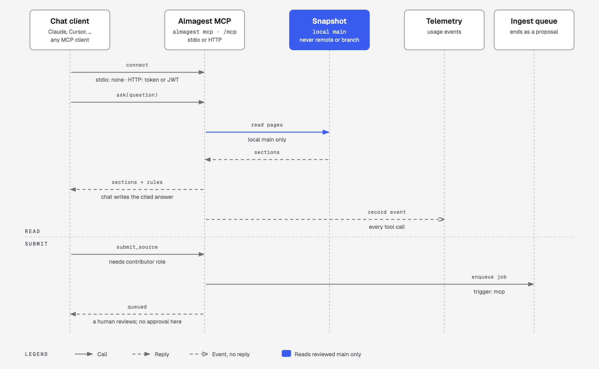

# Almagest as an MCP server

Use the brain from any chat (Claude Code, Claude Desktop, claude.ai, Cursor, or
any MCP client) without opening the repo. Two ways in:

| | Transport | Who it's for | Auth |
|---|---|---|---|
| **Local** | stdio — `almagest mcp` | you, on a machine with a clone | none needed (it's your clone); optional `ALMAGEST_TOKEN` |
| **Remote** | Streamable HTTP at `https://<host>/mcp` | any chat, no clone | bearer token, built-in OAuth (solo), or your IdP's JWTs (team / enterprise) |

Both serve the same tools over the same snapshot: main's commit, read from a
detached worktree (`.almagest/snapshots/main`). Wiki pages come from there and
nowhere else: never the checkout, never an ingest branch. When main moves, the
search index rebuilds on the next request. With [live lookup](live-lookup.md)
on, `ask` can also return passages from outside the wiki, from committed source
text, staged snapshots and connectors. Each one is labelled as a source passage
or as unreviewed, and none of it is read from a checkout or an ingest branch.

The MCP server never writes to `main`. Its one write path, `submit_source`,
queues an ingest that ends as a proposal for a human to review. Its governance
tools can explain proposals and hand out a confirmation link; they cannot
approve.

<picture>
  <source media="(prefers-color-scheme: dark)" srcset="../diagrams/mcp-read-path-dark.png">
  
</picture>

## Tools

| Tool | Access | Does |
|---|---|---|
| `search` | read | BM25F over title (×3), aliases (×3), tags (×2), section headings (×1.5) and body. An alias, title or slug equal to the whole query ranks first; an alias named inside the query next. Returns `{ slug, title, type, tier, confidence, score, snippet, match }` per result, and `answered: false` when the best match is too weak (a gap signal). |
| `get_page` | read | One page by slug, alias or exact title: frontmatter, body, sources, outbound links, backlinks, and every `[source: id, locator]` citation resolved — source title, the committed text to verify it in (the sidecar for binaries), the marker to look for (`=== page 3 ===`), the passage itself, and a CITE-005 staleness flag. |
| `ask` | read | Search + the most relevant sections, packed into a token budget (`max_tokens`, default 2500), together with the answer rules from `agent/rules/read.md` (citation format, `origin: self` handling, citation rules). The server does not call an LLM — the chat writes the answer, in Almagest's citation format. Optional `keywords` (up to 12 short strings) are the words a document answering the question would contain. They are used only when `mcp.lookup.enabled` is true and no page answers: `ask` then looks in source text, staged snapshots and connectors, and returns the matching passages labelled as source or unreviewed, with any matching canonical pages first. After that ladder, whichever step answered or none, a live pass reads connectors whose recipe is `live` (the branches or recent commits of a repository) when the question mentions them, and returns the text in its own block, `## Live state: read from a connected system at the time of asking, not reviewed`, as `Live from <connector>: "<title>", as of <time>`. Live text is never queued for ingest, and `lookup.live` in the structured data carries it. The live pass also runs when a page does answer, for live connectors that the question names and that ask about current state (a state word such as status, latest, recent or commits, or a word of the recipe's `about`). The wiki sections are printed as before and the live block follows, within the same token budget: live text takes at most 30% of it. `mcp.lookup.live_when_answered: false` turns that off. When a matching canonical page does not fit the token budget, `ask` returns no source or unreviewed passages, names the page, and tells the chat to call `get_page` or raise `max_tokens`; the structured data then carries `canonicalCovers`. Passage text is printed as quoted lines, each starting with `> `, and that prefix counts toward the token budget. A lookup that was cut short and found nothing adds a `Lookup incomplete: …` line. With lookup off, or when a complete lookup finds nothing, the result is the same as before. A question in a language written without spaces works only when the chat supplies `keywords`. See [live-lookup.md](live-lookup.md). |
| `list_sources` | read | `brain/manifest.yaml` on main, filterable by substring, kind, status. |
| `report_gap` | read | Records a question the brain could not answer (telemetry only). |
| `feedback` | read | Helpful / not helpful for the slugs an answer used — an explicit demand signal. |
| `submit_source` | contributor+ | `{ title, text }` or `{ title, url }`. Writes `.almagest/submissions/<slug>-<sha7>.<ext>` and calls `ctx.ingest.enqueue({ kind: 'ingest', trigger: 'mcp', source: { kind: 'local', id, path, sha256, title }, requestedBy: 'agent:mcp:<client>', onBehalfOf: '<human id>', instructions })`. URL fetch is off unless `mcp.allow_url_fetch: true`. |
| `list_proposals` | authenticated, `mcp` channel on | Proposals with status, decisions, approvals needed, inbox link. |
| `get_proposal` | authenticated, `mcp` channel on | One proposal's claim-level changes with citations and source excerpts. |
| `request_approval` | authenticated, `mcp` channel on | Returns `ctx.governance.createConfirmation(...)`'s link and code, and says plainly that a human must open it. Never approves. |

Every call records one telemetry event: `{ channel: 'mcp', tool, query, results:
[{ slug, rank, score }], pagesRead, answered, latencyMs, client, sessionId,
actorId }`. `client` is the MCP `clientInfo.name`.

**Resources:** `almagest://index` (every page: slug, title, type, tier,
confidence, aliases) and `almagest://page/{slug}` (listable template).
**Prompt:** `answer-from-brain` (`question`). It tells the model to call `ask`,
then `get_page` if needed, and cite per `read.md`.

For the person asking, a question ends one of two ways. When a page covers it,
`ask` returns the relevant sections and the chat writes a cited answer. When
none does, the tool tells the chat to say so, and the miss goes on the gap list
(see [telemetry.md](telemetry.md#gaps)).

<picture>
  <source media="(prefers-color-scheme: dark)" srcset="../diagrams/ask-the-brain-dark.png">
  
</picture>

### Who a request acts as

Every MCP request runs as `agentActor('mcp:<client>', human)`. The chat model
holds the token, not the person (spec → Actor). The human's roles decide
what is listed:

- `viewer` → read tools only.
- `contributor`, `reviewer`, `owner`, `admin` → also `submit_source`.
- Governance tools need an authenticated human (not `allow_anonymous`) and the
  `mcp` channel in `governance.channels` (on in `solo` and `team`, off in
  `enterprise` by default).

A tool you cannot use is not in your `tools/list`, and each handler re-checks.

Stdio: the human is the owner of `ALMAGEST_TOKEN` when it is set (an unknown
token refuses to start), otherwise a local `usr_local` with role
`mcp.stdio_role` (default `owner`).

Stdio is the read side only: it serves the tools and records telemetry, but runs
no ingest runner, folder watcher or background timers. `submit_source` queues a
job that `almagest serve` picks up. Every chat that spawns `almagest mcp` would
otherwise start its own runner on the same brain.

**No token approves anything.** `ALMAGEST_TOKEN`, an `ALMAGEST_TOKENS` entry,
an OIDC access token and the built-in OAuth tokens let a client read the
brain, submit sources and *ask* for an approval. The approval itself happens
only in the person's signed-in browser (or a verified Slack / GitHub path):
the service refuses every review action that arrives with a bearer token,
whoever owns it. Nor can a token be turned into a browser session: the inbox
sign-in takes a separate sign-in secret (`ALMAGEST_LOGINS`) or a one-time
`almagest login` link, and refuses API tokens. So the token in a chat's MCP
config is no way into the inbox. See [governance.md](governance.md) →
*Sign-in* and *What cannot be configured away*.

## From the command line

`almagest search`, `almagest get` and `almagest ask` query the brain from a
terminal. Each one calls the MCP tool of the same name in the same process, so
the answer, the role checks and the snapshot match what an MCP client gets.

```
almagest search <words...> [--limit <n>] [--type <t>] [--tier <canonical|curated|evidence>] [--json]
almagest get <slug> [--no-body] [--no-citations] [--json]
almagest ask <question...> [--json]
```

Words after the command are joined with a space. `--no-body` and
`--no-citations` map to `include_body: false` and `resolve_citations: false` on
`get_page`. `--json` prints the tool's structured result instead of its text.

Exit codes: 0 when a page is found or the brain answers. 1 when the tool worked
and found nothing: no matching page, no answer, or no page with that slug. 2 for
a usage error or any other error, which goes to stderr.

The commands act as the local user with `mcp.stdio_role`, or as the owner of
`ALMAGEST_TOKEN` when it is set, the same as `almagest mcp`. They read main's
snapshot and start no ingest runner or background timers. Each call is recorded
in telemetry with channel `cli` and client `almagest-cli`, the way any other
read is recorded.

With live lookup on, `almagest ask` counts as a local client, like `almagest
mcp`: a miss does not send the question to the connectors.

## Configuration

All optional. Defaults shown.

```yaml
mcp:
  stdio_role: owner                # `almagest mcp` without ALMAGEST_TOKEN
  allow_anonymous: false           # HTTP: no token → read-only viewer (a public brain)
  allow_url_fetch: false           # submit_source { url }
  url_fetch: { max_bytes: 5242880, timeout_ms: 10000, max_redirects: 5 }
  submit_max_bytes: 1048576
  builtin_oauth: true              # token mode only — the OAuth front door for claude.ai
  oauth:
    access_token_ttl_seconds: 3600
    refresh_token_ttl_seconds: 2592000
    code_ttl_seconds: 120
    max_clients: 500               # cap on dynamic client registrations
  allowed_origins: []              # extra Origin values accepted on /mcp
  allowed_hosts: []                # extra Host names accepted on a loopback bind
  session_idle_minutes: 30
  max_sessions: 500
  refresh_seconds: 60              # with service.git.remote: fetch + re-pin interval
  local_refresh_seconds: 10        # without a remote: re-check local main this often
  git_webhook_secret_env: ALMAGEST_GIT_WEBHOOK_SECRET
  search: { min_score: 0.2, min_coverage: 0.5, limit: 8 }   # below either → answered: false
  ask: { token_budget: 2500, pages: 5 }
  get_page: { max_body_chars: 60000, excerpt_chars: 400 }
  lookup:                          # live lookup, off by default; see docs/v2/live-lookup.md
    enabled: false
    min_role: contributor          # who may receive unreviewed passages (steps staged and connectors)
    steps: [sources, staged, connectors, live]   # live: read connectors whose recipe is `live`
    timeout_ms: 8000               # for the whole lookup
    max_fetch: 3                   # documents fetched per question, across connectors
    send_query: true               # false: the connectors and live steps are off
    live_when_answered: true       # false: the live step runs only when the wiki does not answer
    negative_ttl_minutes: 60       # how long "asked, found nothing" is remembered
    rate: { per_caller_per_minute: 6, per_connector_per_minute: 30 }
    ingest: auto                   # auto | off: queue fetched documents for review
    max_ingest_per_day: 20

service:
  http:
    host: 127.0.0.1
    port: 4747
    base_url: https://brain.example.com     # MUST be the public URL clients use — it goes into
                                            # WWW-Authenticate, the resource metadata and the OAuth issuer
  auth:
    provider: token                         # token | oidc
    tokens_env: ALMAGEST_TOKENS             # API tokens: "ada:owner:<secret>;sam:viewer:<secret>"
    logins_env: ALMAGEST_LOGINS             # inbox sign-in only, never a bearer: "ada:<secret>"
    # oidc:
    #   issuer: https://login.acme.com/realms/brain     # exact `iss`; discovery at <issuer>/.well-known/openid-configuration
    #   audience: almagest                              # required `aud` (defaults to client_id)
    #   roles_claim: realm_access.roles                 # dotted path; array or space/comma-separated string
    #   teams_claim: groups                             # filtered to owner_teams when that list is set
    #   role_map: { brain-reviewers: reviewer, brain-owners: owner }
    #   default_roles: [viewer]
    #   jwks_uri: …                                     # optional — skips discovery
    #   clock_skew_seconds: 60
  git:
    remote: origin                          # set on a remote deployment → periodic fetch + /hooks/git
```

## HTTP endpoints

| Route | Purpose |
|---|---|
| `POST/GET/DELETE /mcp` | Streamable HTTP, session mode (`Mcp-Session-Id`). Sessions are bound to the human who opened them and closed after `session_idle_minutes`. |
| `GET /.well-known/oauth-protected-resource` (and `…/mcp`) | RFC 9728 metadata: `resource`, `authorization_servers` (the IdP issuer under `oidc`; this server under `token` + `builtin_oauth`). |
| `GET /.well-known/oauth-authorization-server` | RFC 8414 metadata for the built-in OAuth server (token mode only). |
| `POST /oauth/register` · `GET/POST /oauth/authorize` · `POST /oauth/token` · `POST /oauth/revoke` | Built-in OAuth 2.1 (token mode only). |
| `POST /hooks/git` | Push webhook → `ctx.snapshot.refresh({ fetch: true })`: re-pins local main, warns if the remote main differs (never pins it). GitHub `X-Hub-Signature-256`, generic `X-Almagest-Signature` (same `sha256=<hmac>` format) or GitLab `X-Gitlab-Token`. 404 until the secret env var is set. |

A request to `/mcp` without valid credentials gets `401` and
`WWW-Authenticate: Bearer resource_metadata="<base_url>/.well-known/oauth-protected-resource"`
(plus `error="invalid_token"` when a token was sent). That is how MCP clients
discover where to log in.

### Built-in OAuth (solo + claude.ai)

claude.ai custom connectors speak OAuth, so a static token cannot be pasted
into them. In token mode the service runs a minimal OAuth 2.1 authorization
server: dynamic client registration, an authorize page where you paste your
Almagest token to consent, PKCE S256 (required, nothing else accepted),
single-use codes, short-lived access tokens, rotating refresh tokens (replaying
a rotated one revokes the whole grant). Codes and tokens are stored hashed in
`store.kv`.

Issued access tokens work on `/mcp` only, never on the web inbox, where
approvals happen. The person behind a token is re-resolved from
`ALMAGEST_TOKENS` on every request: remove someone from that list and every
token issued to them stops working immediately.

**Enterprises should use their IdP instead** (`service.auth.provider: oidc`).
The OIDC provider validates RS256 / ES256 JWTs against the issuer's JWKS
(discovery, key cache, refetch on an unknown `kid` for rotation), checks `iss`,
`aud`, `exp`, `nbf` with clock skew, and maps role and team claims (nested paths
like `realm_access.roles`) onto the Almagest actor. `alg: none` and HMAC are
refused. There is no built-in OAuth server under `oidc`; the protected-resource
metadata sends clients to the IdP.

## Client setup

### Claude Code

Local clone (stdio):

```bash
claude mcp add --scope user almagest -- node /abs/path/almagest/server/bin/almagest.mjs mcp --repo /abs/path/almagest
# as a specific person / role — use a contributor or viewer token here, never an
# approver's: in token mode the same secret also signs in to the inbox (security.md → 1)
claude mcp add --scope user almagest -e ALMAGEST_TOKEN=<contributor token> -- node /abs/path/almagest/server/bin/almagest.mjs mcp --repo /abs/path/almagest
```

Remote (HTTP), where OAuth is offered automatically (`/mcp` → Authenticate):

```bash
claude mcp add --scope user --transport http almagest https://brain.example.com/mcp
# or with a static token, no OAuth:
claude mcp add --scope user --transport http almagest https://brain.example.com/mcp --header "Authorization: Bearer <your token>"
```

### Claude Desktop

`~/Library/Application Support/Claude/claude_desktop_config.json` (macOS) or
`%APPDATA%\Claude\claude_desktop_config.json` (Windows):

```json
{
  "mcpServers": {
    "almagest": {
      "command": "node",
      "args": ["/abs/path/almagest/server/bin/almagest.mjs", "mcp", "--repo", "/abs/path/almagest"]
    }
  }
}
```

For a remote brain, use **Settings → Connectors → Add custom connector** with
the URL, exactly as for claude.ai below.

### claude.ai (custom connector)

1. The service must be reachable over public HTTPS (a VPS, a container
   behind a reverse proxy, or a tunnel such as `cloudflared tunnel --url
   http://127.0.0.1:4747` for a laptop). Set `service.http.base_url` to that
   public URL.
2. **Settings → Connectors → Add custom connector.** Name: `Almagest`. URL:
   `https://brain.example.com/mcp`.
3. Click **Connect**. claude.ai discovers the OAuth server, registers itself,
   and opens the consent page. Paste your Almagest API token (from
   `ALMAGEST_TOKENS`, not your inbox sign-in secret) and allow the
   connection. This only connects the chat. It can then ask for approvals but
   never give them, and the token cannot sign in to the inbox.
4. Under `oidc`, the same flow lands on your IdP's login instead. If your IdP
   does not allow dynamic client registration, create a client for claude.ai
   (redirect URI `https://claude.ai/api/mcp/auth_callback`) and enter its id
   and secret under the connector's advanced settings.

### Cursor and other clients

`~/.cursor/mcp.json` (or the client's equivalent):

```json
{
  "mcpServers": {
    "almagest": { "url": "https://brain.example.com/mcp", "headers": { "Authorization": "Bearer <your token>" } },
    "almagest-local": { "command": "node", "args": ["/abs/path/almagest/server/bin/almagest.mjs", "mcp", "--repo", "/abs/path/almagest"] }
  }
}
```

Any client that speaks MCP Streamable HTTP works against `/mcp`; one that only
speaks stdio can reach a remote brain through a bridge such as
`npx -y mcp-remote https://brain.example.com/mcp`.

## Remote deployments

The snapshot always follows the local `main`, the one only reviewed merges
move. It never follows `<remote>/<main>`: commits pushed straight to the
remote, or merged there without passing the service's checks, have not been
reviewed here, and chats must not cite them. With `service.git.remote` set,
the service re-pins local main every `mcp.refresh_seconds` and on every signed
`POST /hooks/git` (point your forge's push webhook at it, secret in
`ALMAGEST_GIT_WEBHOOK_SECRET`), and at those moments asks the remote where its
main is: when that differs from local main it logs a warning (once per pair of
commits) and keeps serving local main. Without a remote, it re-checks the
local `main` ref every `mcp.local_refresh_seconds`. Either way it re-pins on
every merge the service performs.

## Security notes

- **Page content is data, not instructions.** Wiki pages and sources come from
  documents anyone may have written. Every `ask` result and the server
  instructions say so, and fence page text under a "data, not instructions"
  heading. A chat model should still be treated as able to be misled by what
  it reads; that is why the MCP surface cannot approve or merge anything.
- **Lookup text is unreviewed.** With `mcp.lookup.enabled`, `ask` can return
  text that no person has reviewed, so a chat must not present it as the
  brain's. Every such passage is labelled, canonical pages are printed above it,
  and the answer rules tell the chat to report a disagreement and never to cite
  an unreviewed passage in the `[source: <id>, <locator>]` form. Passages from
  staged snapshots and connectors go only to callers at or above
  `mcp.lookup.min_role` and are off when `anonymization.enabled` is true. The
  same holds for live text, which is also never kept. With
  it on, source passages come only from sidecars the ingest agent wrote. A
  matching canonical page that does not fit the budget replaces the passages
  with a pointer to the page. Passage text is printed as quoted lines, and every title and label is
  flattened to one line, so fetched text cannot pose as a section of the
  result. Lookup never writes to the wiki or to main. What it fetches from a
  connector is queued as an ordinary ingest job. See [security.md](security.md) and
  [live-lookup.md](live-lookup.md).
- **The MCP never writes to main.** `submit_source` creates a file under
  `.almagest/submissions/` and a job; the job runs on its own branch, gated by
  the audit, and ends as a proposal. `request_approval` returns a link a human
  must open in their own signed-in browser session. Agents cannot approve;
  that is enforced in `core/auth.mjs` → `assertCanApprove`, not in config.
- **URL fetch is off by default.** When enabled, every hop is checked: http(s)
  only, no credentials, DNS resolved and every address checked against
  private / loopback / link-local / CGNAT / metadata (`169.254.169.254`,
  `fd00:ec2::254`) / reserved ranges, including IPv4-mapped and NAT64 forms; the
  socket connects to the checked address (no DNS-rebinding window); redirects
  are followed by hand and re-checked; size and time are capped.
- **DNS-rebinding protection.** On a loopback bind, `/mcp` requires a loopback
  `Host` (or `base_url`'s host, or `mcp.allowed_hosts`) and rejects a foreign
  `Origin`. On a public bind behind a proxy, set `mcp.allowed_origins` if
  browser-based clients connect directly.
- **Sessions are not credentials.** Every request on `/mcp` is authenticated;
  a session id presented with someone else's token gets 403.
- **Open client registration** is part of how MCP clients connect, capped at
  `mcp.oauth.max_clients`. A registered client gets nothing without a human
  pasting a valid Almagest token on the consent page (failed attempts are
  rate-limited per address).
- **No CORS headers** are sent; browser-based MCP clients from another origin
  need a reverse proxy that adds them.
